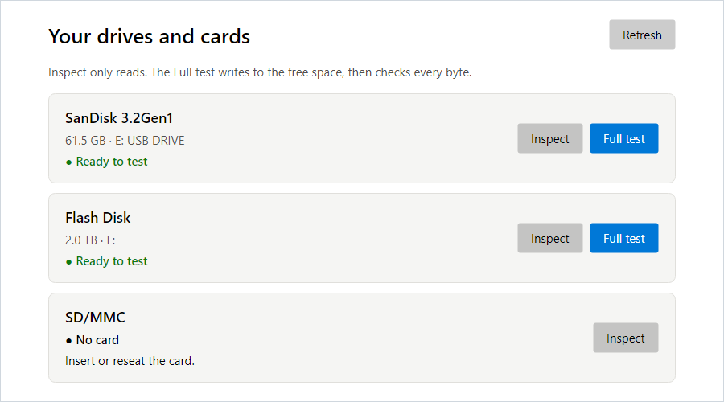
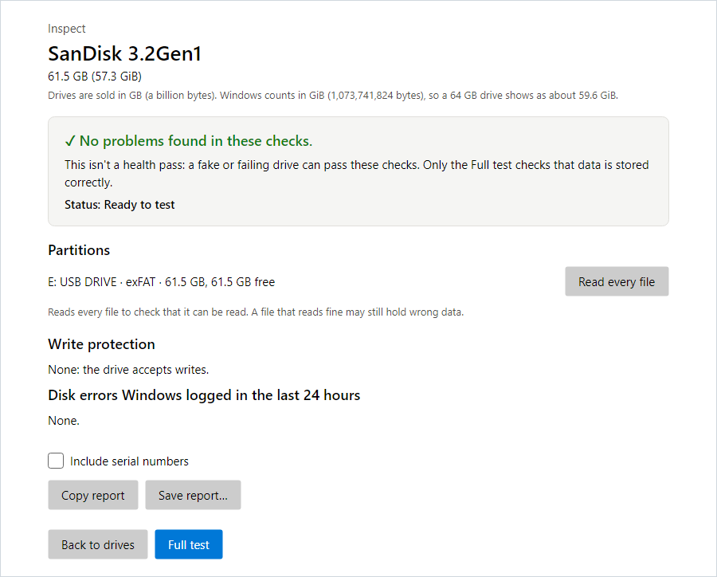
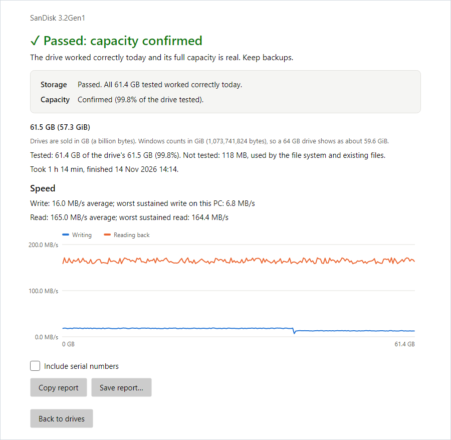
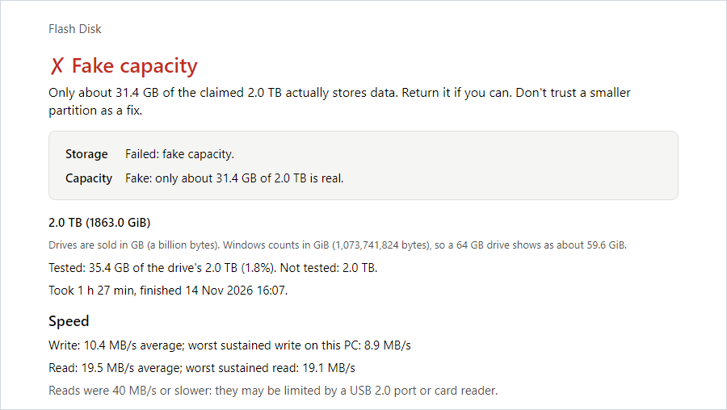
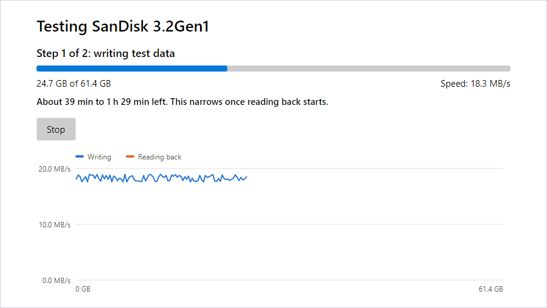

# FlashProof

FlashProof is a free Windows app that tells you whether a USB flash drive, SD card or microSD card can be trusted:

- Does it store data correctly?
- Is its size real, or is it a fake that claims more space than it has?
- How fast is it in practice?
- If it isn't working, what should you do?

It answers in plain words, with a next step for every result. What each result means: [docs/results.md](docs/results.md).



*The screenshots on this page show sample drives.*

## What it does

FlashProof has two modes.

**Inspect** only reads. In seconds, it shows the drive's real size, its partitions, whether it accepts writes, and any disk errors Windows logged in the last 24 hours. It can also read every file on the drive to check that each one can be read.

Inspect isn't a health check: a fake or failing drive can pass it. Only the Full test shows whether the drive stores data correctly.



**The Full test** fills the drive's free space with test data, reads all of it back, and checks every byte. It gives two answers:

- **Storage:** did the space that was tested work?
- **Capacity:** is the drive's size real? This needs about 95% of the drive to be tested, so it's checked only on a drive that's empty or nearly empty.

A drive that passed:



A fake drive that claims 2 TB but holds only about 31 GB:



Your files on the drive are kept: the test writes only to the free space, in a folder of its own, and deletes its test files when it passes. **But if the drive is fake, writing to it can damage the files already on it, so copy them somewhere else first.** For a new drive or card, run Inspect, then the Full test.

The Full test takes a while: about 2 hours for a slow 64 GB drive. FlashProof shows the time left and keeps the computer awake meanwhile.



## What it doesn't do

- **No health score or "remaining life".** A test shows how the drive behaved today. It can't say when the drive will fail, so keep backups.
- **No "genuine" certificate.** A pass means the drive stored data correctly and had its claimed size, not who made it.
- **No repair, formatting or file recovery.**
- **Only USB flash drives and memory cards.** It doesn't test external SSDs or hard drives, and it never writes to the computer's own disks.

## Requirements

- Windows 10 (22H2) or Windows 11, on an x64 or ARM64 PC.
- So far it has been tested on Windows 11 on an x64 PC only. Windows 10 and ARM64 PCs are untested.
- No administrator rights. Nothing to install.

## How to use it

1. Download the exe for your PC from the [Releases](../../releases) page:
   - `FlashProof-win-x64.exe` for most PCs (Intel or AMD).
   - `FlashProof-win-arm64.exe` for ARM PCs, such as laptops with a Snapdragon processor.

   Not sure? In Windows, open Settings > System > About and look at "System type".
2. Plug in the drive or card.
3. Double-click the exe; there's nothing to install. Your drives and cards appear in a list, each with its status. If you plug one in later, press **Refresh**.
4. Click **Inspect**, then **Full test** if you want to know whether the drive can be trusted.
5. Read the result. "Copy report" or "Save report…" gives you a plain-text report to keep or share.

Because the app is new, Windows may show "Windows protected your PC" when you start it. If you downloaded it from this project's Releases page, click "More info", then "Run anyway".

FlashProof isn't digitally signed yet. If your PC has Smart App Control turned on (Windows Security > App & browser control), Windows blocks the app and has no "Run anyway" for it.

**Checking your download (optional).** Each release has a `SHA256SUMS.txt` file. In PowerShell, in the folder where you saved the exe, run `Get-FileHash .\FlashProof-win-x64.exe`. The long code it prints should match the one in `SHA256SUMS.txt` (capital and small letters don't matter).

## Privacy

- FlashProof never connects to the internet, and it collects no usage data.
- Reports stay on your computer unless you share them. Serial numbers are hidden in reports unless you tick "Include serial numbers".
- For each Full test, FlashProof keeps a small record on your computer, in `%LOCALAPPDATA%\FlashProof`. It holds what was tested, including the drive's identity (with its serial number) and where the test files were. You can delete that folder whenever no test is running.

To remove FlashProof, delete the exe and that folder.

## Reporting a problem

Open an issue on this project's [Issues](../../issues) page. A report from the app ("Copy report") helps a lot. It hides serial numbers unless you tick "Include serial numbers".

## License

FlashProof is free software under the GNU General Public License, version 3: see [LICENSE](LICENSE). It includes open-source components under their own licenses: see [THIRD-PARTY-NOTICES.txt](THIRD-PARTY-NOTICES.txt).

## For developers

FlashProof is written in C# on .NET 10, with an [Avalonia](https://avaloniaui.net/) user interface. Building needs the .NET 10 SDK (the exact version is pinned in `global.json`).

```bash
dotnet build
```

```bash
dotnet test
```

```powershell
pwsh -File publish.ps1
```

`publish.ps1` makes both release exes, the license, the notices and `SHA256SUMS.txt` in `artifacts\release`. `dotnet run -c Release tools/make-screenshots.cs` redraws this page's screenshots.

| Project | Purpose |
|---|---|
| `src/FlashProof.Core` | Test engine and verdict rules; platform-independent |
| `src/FlashProof.Windows` | Windows device access and the background worker |
| `src/FlashProof` | The desktop app; the same exe runs the worker with `--worker` |
| `tests/FlashProof.Tests` | Unit and emulator tests for the core |
| `tests/FlashProof.Windows.Tests` | Windows, worker and app tests |

Design and research: [v1-design.md](v1-design.md) (the design), [research-comparison.md](research-comparison.md) (the fact-checked research), and [Test-UsbDrive.ps1](Test-UsbDrive.ps1) (the original PowerShell prototype).
